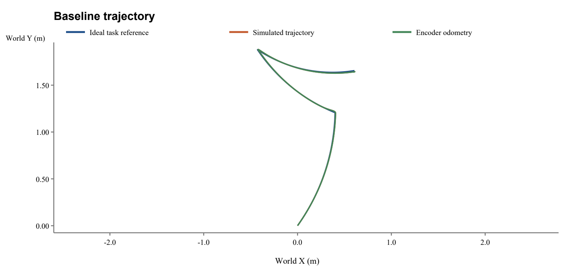
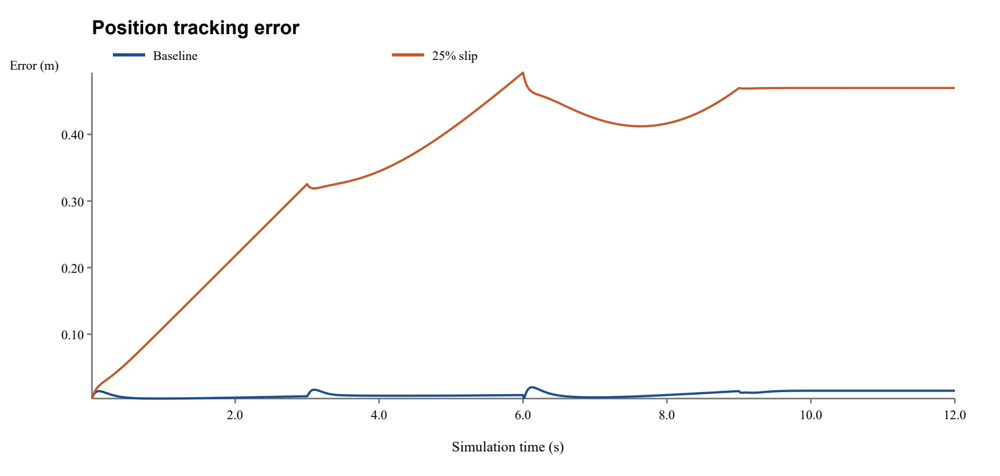
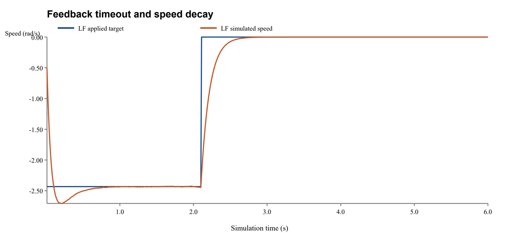

# 麦克纳姆轮底盘预测与模拟实验工作报告

## 1 实验目的与完成情况

本实验基于所给 STM32F407 麦轮底盘工程，完成电脑端 C11 预测仿真程序、嵌入式实验联锁与遥测接口、配置及事件输入、CSV 数据记录和自动报告生成。应用目录及课程设计署名统一为 JHY。电脑端直接编译原工程的逆运动学源码，增加正运动学、电机闭环响应、滑移、噪声及故障模型，形成可重复运行的课程实验系统。

本报告的数值来自实际运行 C 程序后生成的仿真文件。未连接、烧录或运行实物底盘，串口采集接口尚待实车验证。软件仿真可以检验算法和保护分支，实车轨迹精度需要校准及独立定位数据支持。

## 2 实验方案与参数

实验包含基线复合运动、滑移、轮速饱和、反馈掉线、过温和急停六种场景。每次运行均保存输入配置、事件快照、逐步遥测、指标 JSON 和自动分析报告。事件文件在给定时间修改指令或注入异常，避免仅分析恒定输入。

| 参数 | 取值 |
|---|---|
| 半轮距 a 及半轴距 b | 0.215 m；0.2215 m |
| 轮半径及最大目标轮速 | 0.077 m；15 rad/s |
| 基线仿真时长及步长 | 12 s；0.01 s |
| 等效电机模型 | 一阶响应；时间常数 0.12 s；增益 20 rad/s |
| 电脑端 PID | Kp=0.08；Ki=0.6；Kd=0.0004 |
| 默认负载折减及噪声幅度 | 0.08；±0.02 rad/s |
| 随机种子 | 2026 |

这些控制系数对应归一化驱动模型，不能直接作为 固件实车速度环 PID 参数。固件保留原电机参数，所有几何及方向均须在架空条件下校准。

## 3 实施步骤与数据记录

先编译电脑端程序并运行内置自检，再分别加载六个配置文件。配置检查拒绝非有限值、非法几何尺寸、不合适的时间步长和越界事件；正常运行中计算目标轮速、PID 输出、一阶响应及三种位姿，并逐步保存 50 列遥测记录。终端周期输出四轮转速、温度和故障状态，增加 `--realtime` 可按近似墙钟节拍演示。

理想参考使用限幅后的任务目标轮速，模拟轨迹使用电机响应及滑移后的有效轮速，里程计使用有噪声的编码器速度。故障后理想任务参考继续运行，用于反映未完成任务产生的偏差；CSV 中每轮 target 是联锁后实际施加的目标。故障锁存后驱动输出归零，模型轮速按惯性衰减，持续保存后续数据。

实物实验使用 STM32 的 1 ms 控制联锁和 20 ms 遥测队列，USART1 以 420000 baud 输出 26 列快照。电脑端 `tools/Capture-Telemetry.ps1` 只监听并保存原始串口文本、合格 CSV 行及采集元数据，不发送运动命令。该脚本可用于后续实测，当前没有生成任何冒充实测的数据。

## 4 仿真结果

| 场景 | 位置 RMSE m | 航向 RMSE rad | 最终状态 | 首次故障 s |
|---|---|---|---|---|
| 复合运动基线 | 0.01041 | 0.01523 | 正常 | — |
| 25%滑移对比 | 0.38568 | 0.13429 | 正常 | — |
| 目标轮速饱和 | 0.04464 | 0.02131 | 正常 | — |
| LF反馈掉线 | 0.74190 | 0.35299 | LF反馈超时 | 2.100 |
| RF过温注入 | 0.77071 | 0.36696 | RF过温 | 2.000 |
| 软件急停注入 | 0.77071 | 0.36696 | 急停 | 2.000 |

基线记录 1200 个采样点，位置 RMSE 为 0.010405 m，最大位置误差为 0.020314 m。此处 RMSE 表示模拟轨迹相对理想任务参考的跟踪误差，不能解释为预测模型相对实车的准确度。

25% 滑移场景的位置 RMSE 为 0.385681 m。与基线相比，滑移使有效地面轮速降低，模拟位姿逐渐落后；编码器仍反映车轮转动，不能单独给出地面真实位移。这说明仅依靠轮速反馈无法消除轮地滑移导致的位置误差。

轮速饱和场景通过四轮等比例缩放约束目标值，保留运动学模型中的速度比例。掉线场景模拟 LF 反馈中断，超过配置超时后四轮停止驱动；过温和急停场景也进入故障锁存。三种故障均继续记录减速过程，不能把零驱动指令等同于立即静止。

## 5 验证与可靠性分析

电脑端使用 GCC 的 C11 模式和 `-Wall -Wextra -Wpedantic -Werror` 编译，并运行程序自检、六场景回归及独立 CSV 校验。验证重点包括运动学往返、限幅比例、故障锁存、所有故障采样点的四路控制归零、采样时间与行数一致性、数据有限性，以及中文文本追加、删除和替换。实际验证记录保存在 `docs/验证记录.json`，可由验证脚本复算。

关闭噪声，使用 dt 与 dt/2 重新运行相同基线条件，终点位置差为 0.001794677 m，航向差为 0.001415688 rad。这个差值只衡量两个离散分辨率下的数值敏感性；单次步长比较不能证明收敛阶，也不能替代模型与实车的对照实验。事件按控制步起点生效，时间存在小于一个步长的量化误差。

固定随机种子使单次离散实验可复算。若研究随机可靠性，需要在预先规定的多个种子、多个载荷和不同地面条件下重复实验，报告样本数量及统计分布。本次未构造统计置信区间。

## 6 模型和工具的局限性

一阶电机模型省略电气暂态、摩擦非线性及实际减速器损失；统一滑移系数没有描述四轮接触差异、滚子碰撞和载荷转移。温度和电流是教学估算，未经过电机热参数及电流标定。模型没有真实 CAN 仲裁、控制抖动、电池压降和完整刚体动力学，因此不能据此选择电源、保证制动距离或判定实车热安全。

正逆运动学往返通过仅证明公式内部一致。原代码轴向注释、轮滚子布置和电机接线反号仍需逐轮校准。固件编译通过不代表通信时序和保护电路已验收；实物必须保留独立急停、限速试验和安全空间。后续应以独立定位系统测得的位置与角度作为真值，用实测阶跃辨识电机时间常数，并用保留数据评价预测误差。

## 7 文本编辑与成果交流

自动生成的报告支持 `append` 追加、`delete` 删除和 `replace` 替换，输入可使用 UTF-8 文件以稳定处理中文。编辑采用临时文件替换，修改前应自行另存原报告；修改后复核指标、单位及结论与数据一致。Word 版适合提交和答辩，Markdown 版便于再次编辑，CSV 和 JSON 支持复算。

完整交付包括共享运动学源码、电脑端 C 程序及可执行文件、六种场景配置与仿真数据、STM32 实验固件、只读串口采集脚本、设计文档和本报告。各场景自动报告位于 `Simulation/results/场景/report.md`，输入快照位于同目录。
